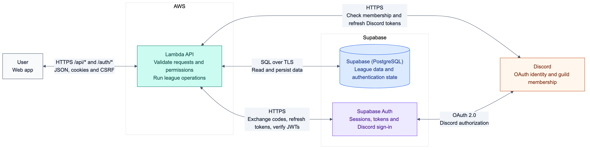
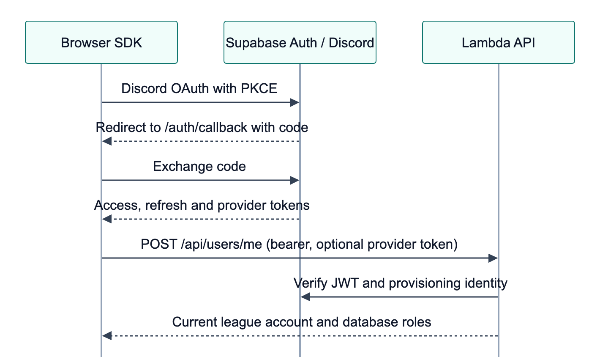
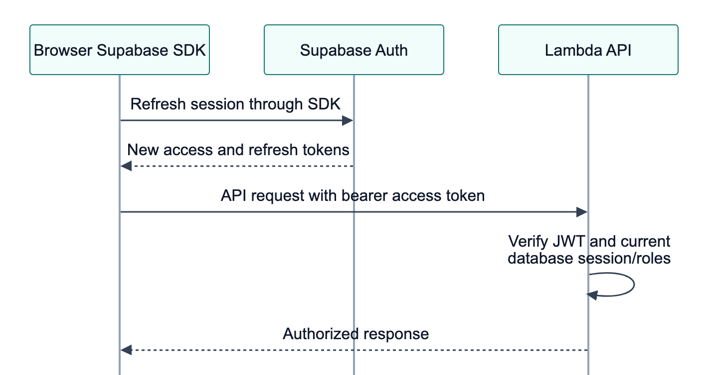
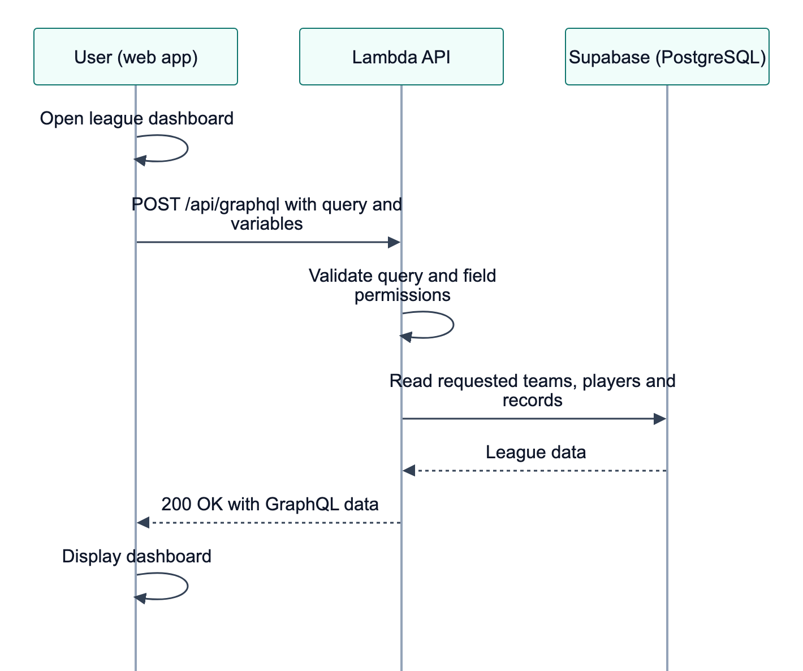
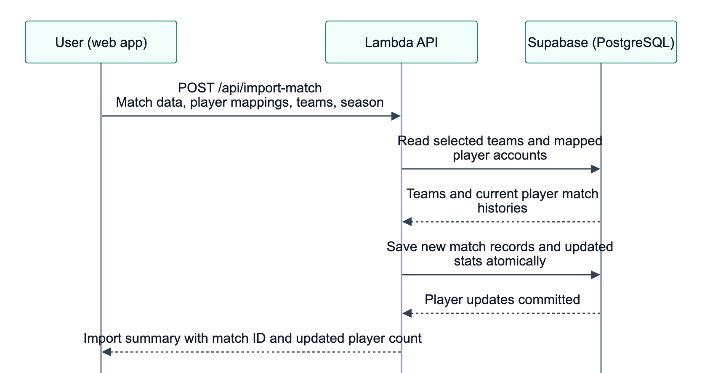
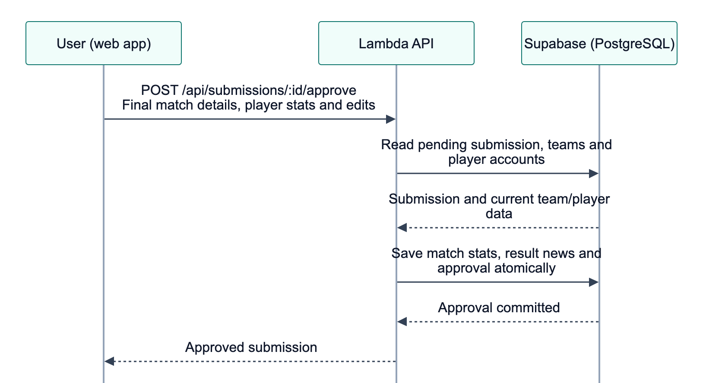
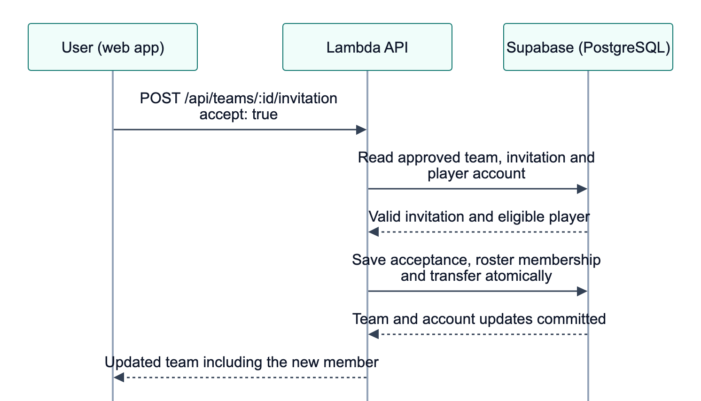
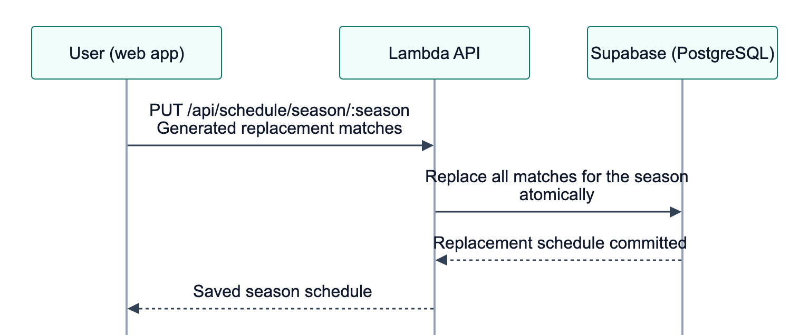
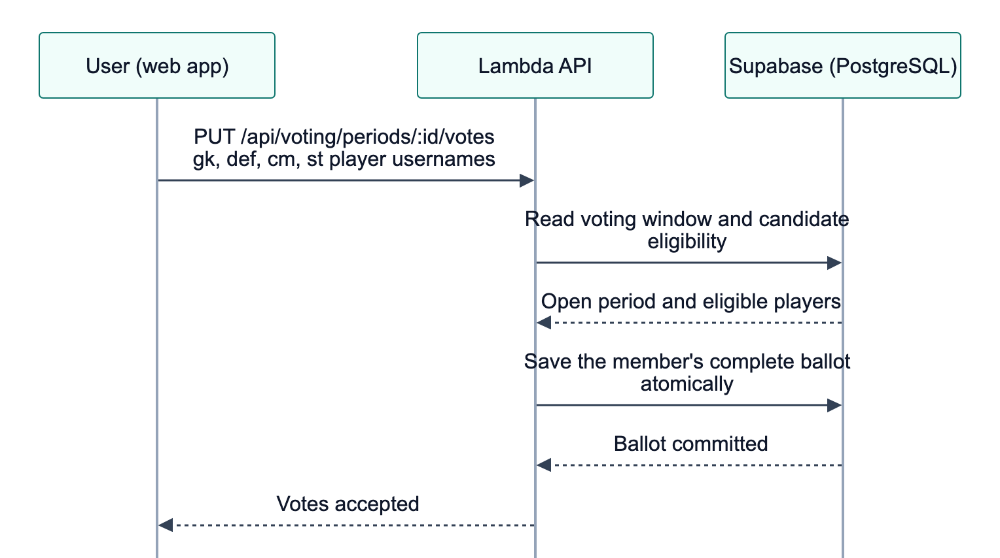

# NAPL

NAPL is a league application built with React and a Fastify API running on AWS Lambda. Apollo Server executes the API's fixed GraphQL reads; REST routes handle commands and other reads. The API reads and writes Supabase PostgreSQL data and uses Supabase Auth with Discord OAuth for sign-in.

## Table of Contents

- [System Architecture](#system-architecture)
- [Sequence Diagrams](#sequence-diagrams)
  - [Discord Sign-in](#discord-sign-in)
  - [Session Refresh](#session-refresh)
  - [League Reads](#league-reads)
  - [Match Import](#match-import)
  - [Match Review](#match-review)
  - [Roster Membership](#roster-membership)
  - [Season Schedule](#season-schedule)
  - [Voting](#voting)
- [Components](#components)
- [How It Works](#how-it-works)
  - [Sign-in and Permissions](#sign-in-and-permissions)
  - [Reading League Data](#reading-league-data)
  - [Updating League Data](#updating-league-data)
- [Browser Cache](#browser-cache)
- [Administrator Assignment History](#administrator-assignment-history)
- [What's not in this repo?](#whats-not-in-this-repo)
- [Local Development](#local-development)
- [Checks](#checks)
- [Production Deployment](#production-deployment)
  - [Prepare and Validate](#prepare-and-validate)
  - [Runtime Settings](#runtime-settings)
  - [Database Capacity](#database-capacity)
  - [Session Keys](#session-keys)
  - [GitHub Deployment Setup](#github-deployment-setup)
  - [Deploy the API](#deploy-the-api)
  - [Configure Vercel](#configure-vercel)
  - [Optional Staging Load Check](#optional-staging-load-check)
- [Rollout and Rollback](#rollout-and-rollback)

## System Architecture



The user sends requests to the Lambda API, which owns validation, permissions, and league operations. Supabase stores league data and authentication state; Supabase Auth handles Discord sign-in. There is no shared Redis. OAuth browser redirects are shown in the sign-in sequence below.

Implementation: [`createRuntime`](api/plugins/runtime.ts), [`createApp`](api/app.ts), [Supabase Auth client](api/plugins/supabase/client.ts), and [Discord client](api/plugins/discord/client.ts).

## Sequence Diagrams

Each diagram follows one happy path from an action to its successful result. Editable Mermaid sources are stored beside the PNGs in [docs](docs).

### Discord Sign-in



Supabase Auth brokers Discord OAuth. The Lambda API verifies the returned identity, checks guild membership, and provisions the league account before setting session cookies. [Implementation](api/plugins/auth/session.ts#L110).

### Session Refresh



An expired access token is renewed through Supabase Auth, and the API returns updated session cookies. This path assumes membership is still current and this request owns the refresh. [Implementation](api/plugins/session/refresh.ts#L31).

### League Reads



Opening the dashboard loads league data through the Lambda API and displays it. This path assumes the browser needs a fresh query. [Implementation](api/routes/graphql/index.ts#L73).

### Match Import



An administrator imports a new match with every player mapped to an account. The API saves the match records and updated player statistics together. [Implementation](api/routes/matches/index.ts#L147).

### Match Review



The retained submission API lets an administrator approve an existing pending submission. Player statistics, result news, and approval status are saved together. The browser's Import tab saves imported matches directly. [Implementation](api/routes/matches/routes.ts).

### Roster Membership



An eligible player accepts an invitation to an approved team. The API saves the roster, account assignment, and transfer history together. [Implementation](api/routes/teams/index.ts#L17).

### Season Schedule



An administrator confirms a generated schedule. The API validates it and replaces the season's schedule in one transaction. [Implementation](api/routes/content/index.ts#L157).

### Voting



A member submits a valid ballot during an open voting period. The API checks the selections and saves the complete ballot together. [Implementation](api/routes/voting/index.ts#L57).

## Components

### Web Application

See the [web guide](web/README.md) for package internals and development commands.

| Component | What it does |
| --- | --- |
| [web/src/features/](web/src/features/) | League screens, admin tools, domain models, commands, and typed query consumers. |
| [web/src/api/](web/src/api/) | Sends HTTP and GraphQL requests, caches reads, handles session refresh, and contains generated GraphQL types. |
| [web/src/auth/](web/src/auth/) | Starts Discord sign-in, loads the current account, and signs out. |
| [web/src/hooks/](web/src/hooks/) | Tracks loading, data, and errors while ignoring outdated request results. |

### Lambda API

See the [API guide](api/README.md) for request handling, data access, and development commands.

| Component | What it does |
| --- | --- |
| [api/app.ts](api/app.ts) | Creates the Fastify app, registers routes, and applies authentication, authorization, request validation, and error handling. |
| [api/routes/](api/routes/) | Implements league queries and transactional commands for accounts, teams, matches, schedules, voting, and administration. |
| [api/plugins/](api/plugins/) | Configures Lambda execution, database connections, session cookies and refresh, and Supabase Auth and Discord clients. |

### Shared Contracts and Database

| Component | What it does |
| --- | --- |
| [pkgs/contracts/](pkgs/contracts/) | Shares validation schemas, domain types, positions, and formations between the web app and API. |
| [supabase/](supabase/) | Contains database migrations, the test fixture, local CLI configuration, and database inspection SQL. |

## How It Works

When the Lambda API starts, it loads its settings and prepares database access and communication with Supabase Auth and Discord. It then sets up the request handlers and permission checks used by the application. The [startup code](api/lambda.ts#L6) brings these pieces together.

### Sign-in and Permissions

When someone opens the app, it checks whether they are signed in. Visitors can browse the public pages; standings require sign-in and appear in the member dashboard. The app checks again when another browser tab reports a session change. The [main screen](web/src/App.tsx#L8) controls this choice.

Choosing “Sign in with Discord” starts authentication through Supabase Auth. Once Discord confirms the user's identity, the API checks their guild membership, creates or loads their league account, and saves session cookies in the browser. Those cookies identify the user on later requests. The [sign-in implementation](api/plugins/auth/session.ts#L110) handles this exchange.

| Class | Where it is used | Responsibility |
| --- | --- | --- |
| [SupabaseClient](api/plugins/supabase/client.ts#L30) | Constructed by `createRuntime`; used by its `provision` callback, `createSession`, and `SessionRefresher`. | Builds login URLs, exchanges authorization codes, verifies tokens, refreshes sessions, and requests logout. |
| [DiscordClient](api/plugins/discord/client.ts#L19) | Constructed by `createRuntime`; used by the login callback and `SessionRefresher`. | Reads Discord identity, checks guild membership, and renews Discord credentials. |
| [PostgresMembershipStore](api/plugins/membership/store.ts#L11) | Passed from `createRuntime` to session handling. | Saves membership eligibility and reads it while still fresh. |
| [PostgresAuthStore](api/plugins/session/pg-store.ts#L9) | Passed to `createSession`, `RateLimiter`, and `SessionRefresher`. | Persists login replay protection, auth quotas, and refresh coordination in PostgreSQL. |
| [CookieCrypto](api/plugins/session/crypto.ts#L11) | Created by `createSession` and shared with `SessionRefresher`. | Encrypts session/login cookies and refresh results; signs and verifies CSRF tokens. |
| [RateLimiter](api/plugins/limits/auth.ts#L23) | Created by `createSession` with the auth store. | Applies authentication request quotas by endpoint, IP, user, and session. |
| [SessionRefresher](api/plugins/session/refresh.ts#L22) | Created by `createSession`; called by `/auth/refresh` and logout when needed. | Coordinates refreshes and renews provider credentials and membership eligibility. |

The API checks permissions for each request using the verified session and the user's roles in the database. Public pages retain their public reads. The standings and team-record endpoints require a verified identity, current guild membership, and an active session, including for direct API requests. Member and administrator actions require the appropriate access. Signed-in GraphQL reads, changes to league data, and administrator reads also check that the session is still active. These rules are enforced by the [request checks](api/app.ts#L123) and [account field definitions](api/routes/accounts/schema.ts#L8).

If a request reports that the session needs renewal, the browser renews it and tries the original request once more. Signing out clears the browser's session and cached data, then tells other tabs to update. See [session renewal](web/src/api/http.ts#L57) and [sign-out handling](web/src/auth/session.ts#L20).

### Reading League Data

The browser selects a named endpoint and supplies its parameters. The Lambda API owns the query and chooses which fields to load. It never executes a query document supplied by the browser.

| Operation | POST endpoint | Used for |
| --- | --- | --- |
| `Standings` | `/api/standings` | Signed-in player/team standings and team records. |
| `MemberLeagueData` | `/api/dashboard` | Member dashboard, news, voting periods, season, and the current account. |
| `TeamRecords` | `/api/team-records` | Signed-in standings and schedule records. |
| `AccountMatches` | `/api/account-matches` | Bounded match-history pages with account, cursor, season, and opponent parameters. |
| `AccountOpponents` | `/api/account-opponents` | Opponent totals for one account. |
| `AccountCardPreviews` | `/api/account-card-previews` | Sample player cards calculated by the API. |
| `DefaultPositionWeights` | `/api/default-position-weights` | Default ranking weights. |

For example, a signed-in standings request is `POST /api/standings` with this body:

```json
{"variables": {}}
```

The [query handler](api/routes/graphql/index.ts) binds each endpoint to its fixed document and executes it through Apollo Server 5 with native CSRF prevention enabled. It rejects client-supplied query text, operation names, extensions, batch bodies, and unexpected variables. Existing argument validation, authorization, history bounds, and cursor checks still apply. `/api/graphql` is not registered.

Canonical selections and fragments live in [API operations](api/routes/graphql/operations/). The [existing generation script](web/scripts/codegen.ts) validates them against the API schema and creates both server execution documents and browser typed documents. The browser uses its documents for Apollo's types and normalized cache; the [transport](web/src/api/link.ts) sends only variables. Generated server documents include the `__typename` fields needed by that cache.

The browser sends these reads and REST commands through the same [request handling](web/src/api/http.ts), retaining cookies and one shared session-renewal attempt. GraphQL reads send JSON and `Apollo-Require-Preflight: true` without fetching a CSRF token. Apollo accepts a non-simple content type such as `application/json` or a nonempty supported preflight header; a simple request without either is rejected. The API also requires the exact configured Origin. REST and `/auth` writes still require the signed CSRF cookie/token and exact Origin. Apollo's header does not authorize those writes.

Database access remains in the API:

- [Account fields](api/routes/accounts/schema.ts) return public profiles, rankings, and card statistics. Private current-account fields require an authenticated caller.
- [Team reads](api/routes/teams/queries.ts) filter teams by the caller's visibility.
- [Team records](api/routes/matches/records.ts) deduplicate imported match histories before aggregation.

Rankings use stored account statistics and configured position weights; card rows use season aggregates. The browser renders those results. Within a request, the API [reuses matching loads](api/routes/graphql/context.ts). Browser caching is described below.

### Updating League Data

When someone saves a change, the browser sends it to the API. The API checks their permissions and validates the submitted data before writing to the database. Related changes are saved together: they either all succeed or are rolled back. The [database implementation](api/plugins/db/client.ts#L10) also protects these writes from conflicting concurrent changes and gives each transaction a 15-second time limit.

Administrators enter match statistics through the [Import tab](web/src/features/admin/AdminPanel.tsx#L153). A successful import follows four steps:

1. The administrator uploads a match export, selects the teams, and connects each exported player to a league account. The [file reader](web/src/features/matches/match-import.tsx#L62) prepares the export for review.
2. After confirmation, the browser sends the match details, player mappings, team IDs, season, and any tackle corrections to the API. See [import submission](web/src/features/matches/match-import.tsx#L97).
3. The API validates the import, adds the match to each mapped player's history, and recalculates their statistics. These account updates are saved together by the [import handler](api/routes/matches/index.ts#L147).
4. The app shows the match ID and import counts, then [reloads league data](web/src/features/admin/AdminPanel.tsx#L38) so the updated results appear on screen.

Other league changes follow the same pattern of checking permissions, validating input, and saving related records together:

| Action and caller | Feature API → endpoint | Server implementation |
| --- | --- | --- |
| [TeamsView.respondInvitation](web/src/features/teams/teams-view.tsx#L78) | [teams.respondInvitation](web/src/features/teams/api.ts#L13) → `POST /api/teams/:id/invitation` | [registerTeams](api/routes/teams/index.ts#L205) records acceptance; for an approved team, [moveMember](api/routes/teams/index.ts#L17) updates the roster, account assignment, and transfer history. |
| [GenerateScheduleModal.handleGenerate](web/src/features/matches/schedule-setup.tsx#L70) | [matches.replaceScheduledSeason](web/src/features/matches/api.ts#L15) → `PUT /api/schedule/season/:season` | [registerContent](api/routes/content/index.ts#L157) validates `scheduleInput` rows and replaces the season's scheduled matches. Schedule generation itself happens in the browser. |
| [VotingTab.handleSubmit](web/src/features/voting/VotingTab.tsx#L63) | [voting.submitTotwVotes](web/src/features/voting/api.ts#L10) → `PUT /api/voting/periods/:id/votes` | [registerVoting](api/routes/voting/index.ts#L57) validates `voteInput`, checks the voting window and candidates, and replaces the member's ballot. |

The [shared validation rules](pkgs/contracts/src/index.ts) define the accepted data for these commands. Manual submission and approval endpoints remain implemented and tested in the [API](api/routes/matches/routes.ts), including `POST /api/submissions/:id/approve`. Their unreachable browser forms have been removed. Imported matches are saved directly; they do not pass through manual approval.

After a successful change, the browser [clears cached query results and stops older queries still in progress](web/src/api/client.ts#L20). Apollo refetches active GraphQL queries; REST screens keep their explicit reloads. Late responses cannot refill the cache with old data.

## Browser Cache

GraphQL screens use Apollo's React hooks and normalized `InMemoryCache` with `cache-first`. A complete cached result is reused without another request, and simultaneous identical queries share a request. Mounted screens subscribe to cache changes. Explicit refresh uses Apollo's `refetch()`; it does not permanently force later reads onto the network.

There is no custom 30-second expiry or 32-entry whole-cache wipe. Results stay in browser memory until invalidation, session clearing, or page reload. Changes made by another user appear after a refresh. REST-only screens retain their existing loading hooks.

Successful REST commands clear cached GraphQL reads, cancel older reads, and refetch active queries through Apollo's native lifecycle. Failed commands leave the cache intact. A failed refetch is shown as a read error and does not turn a completed write into a failed command. Named read requests do not invalidate the cache.

Session changes and logout clear the cache without refetching the departing user's queries. Public `Account` and private `CurrentAccount` remain separate cache types. The response link validates opaque domain data before passing it to Apollo; malformed data and partial GraphQL failures cannot become successful cached results. See the [client lifecycle](web/src/api/client.ts), [transport](web/src/api/link.ts), and [HTTP handling](web/src/api/http.ts).

The API's reuse of data within a single request ends with that request. It is independent of the browser cache.

Run browser tests for cache reuse, explicit refetch, reactive updates, validation, command invalidation, cancellation, and session isolation:

```sh
pnpm --filter @napl/web test
```

The relevant checks are in the [cache tests](web/test/cache.test.ts), [client lifecycle tests](web/test/client.test.ts), and [GraphQL tests](web/test/graphql.test.ts).

See the [frontend hook/helper inventory](web/README.md) for the retained REST lifecycle and helper responsibilities.

## Administrator Assignment History

Only a verified super administrator can change the administrator list. The API checks that the selected accounts exist, removes repeated IDs, and compares the selection with the current list. Reordering the IDs or changing their capitalization still counts as the same selection and creates no history entry. This action changes administrator assignments while leaving super-administrator assignments intact. See the [assignment handler](api/routes/admin/index.ts#L11).

Every changed list records who made the change, when the database saved it, and the complete lists before and after the change. The actor comes from the verified session. The assignments and their history are saved together, so a failure to record the history also prevents the assignment change. Concurrent changes either save complete lists with matching history or return a conflict.

Apply the [assignment-history migration](supabase/migrations/202610140001_role_audit.sql) before deploying this API behavior. The API's database login can append history but cannot read, edit, delete, or clear it. Browser roles have no access. The migration owner can inspect the records directly. Deleting an account does not erase its history because the records are retained independently of the account.

The integration tests check permissions, unchanged selections, rollback, concurrent changes, and database access restrictions using disposable PostgreSQL databases. Run them with Node 24 and Docker:

```sh
pnpm run test:integration
```

See the [assignment tests](api/test/routes/admin-audit.test.ts) and [database permission tests](api/test/integration/role_audit.sql).

## What's not in this repo?

- **Hosted service implementations.** Supabase Auth and Discord OAuth run outside this application. The repository contains the [Supabase](api/plugins/supabase/client.ts) and [Discord](api/plugins/discord/client.ts) clients that call them.
- **A production database snapshot.** The [migrations](supabase/migrations/) extend an existing database baseline. The [test fixture](supabase/fixtures/legacy.sql) supports disposable integration databases; it is not a production backup.
- **Deployment secrets and provider setup.** Live credentials, cookie keys, and OAuth application settings must be supplied separately. The [environment example](api/.env.example) lists required values, and [Production Deployment](#production-deployment) covers the external setup. The included [SAM template](api/template.yaml) provisions Lambda resources; it does not create the Supabase or Vercel projects.

## Local development

### Docker Compose

Use Docker, Node 24, and pnpm 10.15.1. Run from the repository root:

```sh
pnpm install --frozen-lockfile
pnpm run setup:env
```

`setup:env` creates [`api/.env`](api/.env.example) and [`web/.env`](web/.env.example) from their examples and generates missing `COOKIE_KEYS` and a shared `ORIGIN_SECRET`. Existing settings and keys are preserved. Fill in the hosted Supabase and Discord settings in `api/.env` before starting the app:

| Setting | Local development value |
| --- | --- |
| `NODE_ENV`, `PUBLIC_ORIGIN` | `development` and `http://localhost:5173`, with no trailing slash or path. |
| `DATABASE_URL` | The configured hosted PostgreSQL connection with the API's runtime permissions and `sslmode=verify-full&sslrootcert=prod-ca-2021.crt`. |
| `SUPABASE_URL`, `SUPABASE_PUBLISHABLE_KEY` | Your hosted project's URL and publishable key. |
| `SUPABASE_JWKS_URL` | `https://PROJECT.supabase.co/auth/v1/.well-known/jwks.json` for that project. |
| `DISCORD_CLIENT_ID`, `DISCORD_CLIENT_SECRET`, `DISCORD_GUILD_ID` | The OAuth application's credentials configured in Supabase and the guild whose membership the API checks. |

Download the project's server root certificate from Supabase **Database Settings → SSL Configuration** to `api/prod-ca-2021.crt`, following the [SSL connection guide](https://supabase.com/docs/guides/database/connecting-to-postgres#connecting-with-ssl). The relative `sslrootcert=prod-ca-2021.crt` path works from the native API's `api/` working directory; Compose mounts that file read-only at `/var/task/prod-ca-2021.crt`. Keep the downloaded certificate local.

Keep `ORIGIN_SECRET` equal in both app files. The earlier browser-only app used root `VITE_SUPABASE_*` settings; this web app calls the API and uses the two app files above. Discord OAuth remains configured in Supabase Dashboard. Local startup reads the saved files without generating keys or changing them.

```sh
./scripts/dev.sh
```

Open **http://localhost:5173**. Compose starts only the web app, the local HTTP adapter, and the API in AWS's Node 24 Lambda container. The API uses the hosted Auth service and database configured in `api/.env`; Compose does not replace those settings. AWS credentials are not required for this local runtime. Pass `-d` to start in the background: `./scripts/dev.sh -d`.

**Local application actions use the real configured database.** Sign-in can create an account and auth state; authorized league changes write to that database. Startup does not create a database, apply migrations, or seed sample data. The configured database must already have the application's schema and runtime grants. Use the [disposable integration checks](#checks) when testing changes that should not touch hosted data.

| File | Responsibility |
| --- | --- |
| [`docker-compose.yml`](docker-compose.yml) | Connect services and start them in dependency order. |
| [`api/Dockerfile`](api/Dockerfile) | Package the API and run it in AWS's Lambda runtime image. The deployment SAM template remains in `api/template.yaml`. |
| [`web/Dockerfile`](web/Dockerfile) | Run the frontend with live reload. |
| [`supabase/`](supabase/) | Keep database migrations and disposable test fixtures. |
| [`scripts/dev.sh`](scripts/dev.sh) | Start and rebuild the local application containers. |

| Service | Local address | Purpose |
| --- | --- | --- |
| Web | `http://localhost:5173` | Browse the app; its proxy forwards `/api` and `/auth` to the Lambda handler. |
| Lambda invocation | `http://localhost:9000/2015-03-31/functions/function/invocations` | Invoke the runtime with a Lambda event; browser requests go through the web app. |

Open **`http://localhost:5173`** with the local `PUBLIC_ORIGIN` above. `http://127.0.0.1:5173` is a different browser origin; sign-in and GraphQL POST requests from it fail the API's exact-Origin check. Compose reads `PUBLIC_ORIGIN` from `api/.env`, so a production frontend origin must be changed explicitly for localhost development. All published ports bind only to your machine. The `api` service translates HTTP requests into Lambda Function URL events; the Lambda container executes the packaged API. AWS's Runtime Interface Emulator exercises that runtime and event handling, but does not reproduce AWS IAM authorization or scaling.

Keys persist in the ignored app `.env` files. Production CI receives its settings separately from GitHub secrets and variables.

If upgrading from the old Compose stack, run `docker compose --env-file api/.env down --remove-orphans` before starting it again. This removes the old database/Auth containers and frees their ports without deleting their saved volume. The new stack does not use that volume.

### Discord sign-in with Compose

Use the hosted project's [Discord provider settings](https://supabase.com/docs/guides/auth/social-login/auth-discord):

1. Keep the Discord application's redirect pointed at Supabase's hosted callback, normally `https://PROJECT.supabase.co/auth/v1/callback`. Enable Discord in Supabase Dashboard with that application's client ID and secret.
2. In Supabase Auth URL Configuration, add `http://localhost:5173/auth/callback**` to the [redirect allowlist](https://supabase.com/docs/guides/auth/redirect-urls). The API includes a `transaction` query parameter in this callback. Keep existing production redirects and the production Site URL.
3. Set the same Discord client ID/secret and the intended `DISCORD_GUILD_ID` in `api/.env`. Run `./scripts/dev.sh` to apply the configuration, open `http://localhost:5173`, and choose **Sign in with Discord** with an account in that guild.

Discord returns to hosted Supabase Auth, which redirects to the local app's `/auth/callback`. The local API completes the PKCE exchange, verifies guild membership, and provisions the account in the configured database before setting local browser session cookies.

The API still needs the Discord credentials: it refreshes provider tokens and checks guild membership. Supabase refreshes its own sessions but [does not refresh provider tokens](https://supabase.com/docs/guides/auth/social-login). These server credentials do not belong in the browser's environment.

### Working with the containers

Edits under `web/src` reload in the browser. API code is packaged into the Lambda image; restarting an existing container does not update that code. Rebuild it after API changes:

```sh
./scripts/dev.sh -d lambda
```

Rebuild both images after shared-contract or dependency changes with `./scripts/dev.sh -d lambda web`. Changes to web files outside `web/src`, including Vite configuration, also require rebuilding the web image.

| Command | Purpose |
| --- | --- |
| `docker compose --env-file api/.env logs -f web api lambda` | Follow local application logs. Hosted Auth logs are in Supabase. |
| `docker compose --env-file api/.env down` | Stop and remove the application containers; hosted data and local environment files remain. |

### Native pnpm alternative

After configuring the same hosted settings above, you can run the web and API directly on your machine. Stop Compose first if it is using port 5173, then generate the code:

```sh
docker compose --env-file api/.env down
pnpm run generate
```

Run `pnpm run dev:api` and `pnpm run dev` in separate terminals. The API reads `api/.env` and uses its hosted database/Auth settings; Vite reads `web/.env`. The native API listens at `http://127.0.0.1:3000` by default.

Vite listens on `http://localhost:5173` and proxies `/api` and `/auth` using `LOCAL_API_URL`, then `API_URL`, then the default API address. Keep `ORIGIN_SECRET` equal in both app files and never prefix secrets with `VITE_`.

## Checks

```sh
pnpm run generate
pnpm run gql:check
pnpm run typecheck
pnpm run lint
pnpm run build
pnpm run test:integration
sam validate --lint --template-file api/template.yaml
```

The integration runner creates disposable PostgreSQL containers, applies fixtures and migrations, and runs the workspace tests, including authorization, schedule rollback/concurrency, server commands, GraphQL validation, session isolation, and theme behavior. It also checks the bundled Lambda package outside the repository. It does not modify live data. `pnpm run test:sam` additionally invokes the package through SAM's local container.

## Production deployment

Vercel serves the frontend and forwards its API requests to Lambda. The forwarding code uses temporary AWS credentials to sign requests, and Lambda checks a shared secret before handling them. User sign-in and permission checks still apply after these infrastructure checks. See the [request forwarding implementation](web/server/proxy.ts).

The [deployment template](api/template.yaml) creates the Lambda function, its live version alias, execution permissions, a CloudWatch log group with 14-day retention, and permission for the production Vercel project to invoke the API. Its defaults are Node 24 on ARM64, 512 MiB of memory, and a 60-second timeout. It uses the account's available concurrency unless a reservation is explicitly configured. Supabase and Vercel projects are set up separately. The template does not add a custom network, a separate content-delivery service, or pre-warmed Lambda capacity.

### Prepare and Validate

Use Node 24, pnpm 10.15.1, AWS credentials for the intended account, and SAM CLI 1.165.0 or later. Docker is required for the database integration tests and optional local Lambda invocation. Run commands from the repository root.

Install dependencies, then run the full set of [checks](#checks):

```sh
pnpm install --frozen-lockfile
```

The build produces the web assets and the Lambda package at `api/dist/api.zip`. The [packaging script](api/scripts/build.mjs) includes only the bundled handler and its package metadata in that ZIP. The build also checks the Vercel forwarding bundle, while integration tests exercise the Lambda package outside the repository against disposable PostgreSQL data. These steps do not deploy cloud resources.

To additionally invoke the packaged API in a local Lambda container, run:

```sh
pnpm run test:sam
```

### Runtime Settings

Start with the [environment example](api/.env.example). The setup command initializes both app files, preserves valid existing keys, and rejects malformed keys instead of replacing them.

```sh
pnpm run setup:env
```

Supply production values through a protected local file or the deployment environment. Environment values take precedence over the local file when generating deployment parameters.

| Setting | Purpose |
| --- | --- |
| `DATABASE_URL` | One Supabase PostgreSQL connection URL for league data and authentication state. Its restricted runtime login must inherit both `app_runtime` and `gateway_runtime`; use `sslmode=verify-full` in production. |
| `SUPABASE_URL`, `SUPABASE_PUBLISHABLE_KEY` | Supabase project HTTPS URL, such as `https://PROJECT.supabase.co`, and authentication publishable key. |
| `SUPABASE_JWKS_URL` | Full signing-key endpoint, usually `https://PROJECT.supabase.co/auth/v1/.well-known/jwks.json`. Used only to fetch keys; the issuer comes from the project Auth URL. |
| `DISCORD_CLIENT_ID`, `DISCORD_CLIENT_SECRET`, `DISCORD_GUILD_ID` | Discord OAuth application credentials and the guild used for membership checks. |
| `PUBLIC_ORIGIN` | Exact HTTPS address of the public frontend, without a path or trailing slash. Configure allowed sign-in redirects for this frontend origin. |
| `COOKIE_KEYS` | Persistent JSON key ring shared by all API instances. Each key is a base64-encoded 32-byte value. |
| `ORIGIN_SECRET` | Secret shared by Vercel and the API, at least 32 characters long. |
| `VERCEL_TEAM_SLUG`, `VERCEL_PROJECT_NAME` | Deployment-only inputs for the AWS trust policy: the exact Vercel team slug and project name allowed to invoke the production API. Supply them as GitHub Actions variables, not browser or Lambda runtime settings. |
| `SUPABASE_SECRET_KEY` | Optional server secret key for forwarding the original client IP to Supabase. |
| `DISCORD_TRANSFER_WEBHOOK` | Optional destination for roster notices. |
| `EXISTING_VERCEL_OIDC_PROVIDER_ARN` | Optional existing AWS identity provider for the Vercel team, reused instead of creating another. |
| `APPLICATION_ROLE_BOUNDARY_ARN` | Permissions boundary created by the deployment bootstrap, limiting the permissions of application roles. |

If production `DATABASE_URL` specifies `sslrootcert`, that certificate must be available at the configured path in the deployed runtime. The local Compose certificate mount does not supply it to a production deployment.

The generated AWS trust policy accepts only the named project's production Vercel environment. These team/project inputs need not already exist in a Vercel application's environment: the deployment uses their values to match Vercel's [OIDC identity claims](https://vercel.com/docs/oidc/aws). The proxy's runtime settings are listed under [Configure Vercel](#configure-vercel). Preview deployments need their own access; they do not inherit production permission.

### Database Capacity

League data and authentication state use the same `DATABASE_URL` and database login. Each Lambda environment still has two database clients, each limited to one connection. Ten active environments can therefore use roughly 20 connections. Leave additional room for warm environments, overlapping releases, migrations, and other database users.

The template omits reserved concurrency by default. New AWS accounts can have a concurrency quota too small to support a reservation. Once the account permits it, set the template's `ReservedConcurrency` parameter to a positive limit that fits the database budget. Its default of `-1` means no reservation; `0` disables invocation. The account's shared quota can change, so it is not a permanent function-specific limit or spending cap.

Use the database provider's transaction pooler and choose Lambda concurrency to fit the actual connection budget. The defaults are starting settings, not measured capacity guarantees. The [application connection settings](api/plugins/db/client.ts#L23) and [authentication connection settings](api/plugins/runtime.ts#L14) define these limits.

### Session Keys

Keep the existing cookie keys when moving sessions to Lambda. All API instances need the same key ring so they can read the same session cookies.

When rotating keys, put the new key first and retain the older keys until their sessions expire. Keep those keys available to any version you might roll back to. Generating replacement keys at application startup would make existing sessions unreadable. The [setup script](api/scripts/setup-env.mjs) manages initial key creation separately from startup.

### GitHub Deployment Setup

An AWS administrator creates the [deployment bootstrap](api/deploy-bootstrap.yaml) once. It creates GitHub federation, a private deployment bucket, a deployment role, and a CloudFormation execution role. A permissions boundary limits the application roles, and GitHub cannot modify the bootstrap through its deployment role. GitHub access starts disabled.

```sh
aws cloudformation deploy \
  --profile napl --region us-east-2 \
  --template-file api/deploy-bootstrap.yaml \
  --stack-name napl-deployment \
  --capabilities CAPABILITY_IAM
```

Configure the **Production** environment under GitHub **Settings → Environments** and store deployment values under **Settings → Secrets and variables → Actions** at repository scope:

1. Under **Deployment branches and tags**, select **Selected branches and tags** and allow only the **branch** named `main`. Do not add a tag rule or wildcard.
2. Add the repository secrets and variables below. Secrets belong in **Repository secrets**, not ordinary variables. The Production job inherits these repository settings.
3. Keep releases automatic; no required reviewer is needed for this workflow.

| Repository secret | Where to obtain it |
| --- | --- |
| `DATABASE_URL` | Supabase PostgreSQL connection for the shared runtime login, with `sslmode=verify-full`. |
| `DISCORD_CLIENT_SECRET` | Discord Developer Portal → application → OAuth2 client secret. |
| `COOKIE_KEYS` | Existing API key ring; preserve it during deployment. For a first installation, generate it once with the setup command and retain it securely. |
| `ORIGIN_SECRET` | Existing secret shared by Vercel and the API. For a first installation, generate it once and configure the same value in both places. |
| `SUPABASE_SECRET_KEY` | Optional Supabase server secret key. |
| `DISCORD_TRANSFER_WEBHOOK` | Optional Discord webhook URL for roster notices. |

The database login requires both runtime role grants and the migrations described in [Runtime Settings](#runtime-settings) and [Rollout and Rollback](#rollout-and-rollback). Use a restricted runtime login rather than the database administrator account. The same login serves league data and authentication state, so it has the combined permissions of both runtime roles.

| Repository variable | Value or source |
| --- | --- |
| `AWS_REGION` | `us-east-2` |
| `AWS_DEPLOY_ROLE_ARN` | Bootstrap stack output `GitHubDeployRoleArn`. |
| `AWS_CLOUDFORMATION_ROLE_ARN` | Bootstrap stack output `CloudFormationExecutionRoleArn`. |
| `AWS_DEPLOYMENT_BUCKET` | Bootstrap stack output `DeploymentBucket`. |
| `APPLICATION_ROLE_BOUNDARY_ARN` | Bootstrap stack output `ApplicationRoleBoundaryArn`. |
| `SUPABASE_URL`, `SUPABASE_PUBLISHABLE_KEY` | Supabase project URL and publishable API key. |
| `SUPABASE_JWKS_URL` | Supabase signing-key endpoint: `https://PROJECT.supabase.co/auth/v1/.well-known/jwks.json`. |
| `PUBLIC_ORIGIN` | Public website's exact HTTPS origin. |
| `DISCORD_CLIENT_ID`, `DISCORD_GUILD_ID` | Discord application ID and league server ID. |
| `VERCEL_TEAM_SLUG`, `VERCEL_PROJECT_NAME` | Vercel team's URL slug and project name. |
| `EXISTING_VERCEL_OIDC_PROVIDER_ARN` | Optional; use only when the Vercel team's AWS provider already exists. |

After verifying that GitHub's environment allows only the `main` branch, the AWS administrator enables the deployment role:

```sh
aws cloudformation deploy \
  --profile napl --region us-east-2 \
  --template-file api/deploy-bootstrap.yaml \
  --stack-name napl-deployment \
  --capabilities CAPABILITY_IAM \
  --parameter-overrides EnableGitHubDeployment=true
```

The role accepts only this repository's `Production` environment identity. GitHub exchanges that identity for temporary AWS credentials on each deployment. Keep the branch restriction in place: an environment identity does not itself identify the branch. No permanent AWS access key belongs in GitHub.

### Deploy the API

The [CI/CD workflow](.github/workflows/ci-cd.yml) runs once per push. Its summary shows four sequential jobs: **Lint → Test → Build → Deploy**. Each job starts only after the preceding job succeeds, and Deploy runs only for pushes to `main`. Prepare the production configuration before merging the deployment changes into `main`.

| Stage | What happens |
| --- | --- |
| Lint | Run ESLint with zero warnings allowed. Then generate the Prisma client, check GraphQL freshness, type-check every workspace, and validate both SAM templates. Each operation has its own named step and log entry. |
| Test | Generate the test runner's Prisma client, then run API and web tests against disposable PostgreSQL. The test command prepares the shared contracts it needs. |
| Build | Generate the build's Prisma client, build shared contracts, bundle Lambda, and build the frontend and proxy in separate ordered steps. Verify the finished Lambda ZIP outside the repository against disposable PostgreSQL. On `main`, upload that exact tested ZIP and template for deployment. |
| Deploy | Download the tested artifact without rebuilding it, validate production configuration, confirm that the commit is still current on `main`, obtain temporary credentials, and update the `napl-api` stack in Ohio. Confirm that anonymous Function URL access is rejected and invoke the live alias to read the current season. Clean up deployment parameter files even on failure. Deployments run one at a time. |

The [parameter generator](api/scripts/sam-env.mjs) validates production settings, checks Lambda's 4 KiB environment limit, and writes a protected parameter file. The workflow removes its secret files after each run; they are never deployment artifacts. Avoid SAM debug logging because it can reveal parameters.

A new Lambda version becomes active through the `live` alias. CloudFormation normally rolls back a failed infrastructure update. A failed smoke check after deployment marks the workflow failed but does not undo that release; revert the change on `main` and let the workflow deploy a compatible revision. Preserve the active cookie keys when rolling back.

The smoke check verifies access to league data. It does not verify Discord sign-in, access to authentication state, or Vercel forwarding. Complete those checks through the website after configuring Vercel. The workflow does not run production migrations or coordinate Vercel's separate deployment process.

### Configure Vercel

Set the Vercel project root to the web directory and allow the build to access files outside it so the shared packages are available. The [Vercel configuration](web/vercel.json) builds the frontend and shared contracts, serves the generated assets, and forwards API requests through the server function. Use Node 24 for that function.

Set these values in Vercel's server-only production environment:

| Vercel setting | Source |
| --- | --- |
| `API_URL` | The deployment's `FunctionUrl` output. |
| `AWS_ROLE_ARN` | The deployment's `VercelInvokeRoleArn` output. |
| `AWS_REGION` | The Lambda function's AWS region. |
| `ORIGIN_SECRET` | The same secret supplied to the API. |

Keep these values out of browser-exposed settings; the `VITE_` prefix would publish them in the browser bundle. Vercel uses its deployment identity to obtain temporary AWS credentials. The forwarding code signs requests, carries session cookies in both directions, and prevents response caching. It allows 55 seconds for a request and does not retry writes. Confirm that the selected Vercel runtime supports that duration.

### Optional Staging Load Check

The [load runner](api/test/load/run-staging.mjs) measures signed-in standings reads against an explicitly selected staging environment. Use an isolated staging project and database with their own invocation permissions. A Vercel preview hostname alone does not establish that an environment is isolated from production.

```sh
pnpm run test:load --help
```

| Setting | Requirement or purpose |
| --- | --- |
| `LOAD_STAGE` | Required; must be `staging`. |
| `LOAD_BASE_URL` | Required HTTPS URL whose hostname contains `staging` or ends in `.vercel.app`. Verify that it points to the isolated staging system. |
| `LOAD_DB_CONNECTION_BUDGET` | Required positive database connection budget, recorded in the report. |
| `LOAD_ROUNDS` | Optional; between 1 and 5 rounds. |
| `LOAD_LAMBDA_RESERVED_CONCURRENCY` | Optional concurrency setting recorded in the report. |
| `LOAD_COOKIE` | Required authenticated staging session cookie; standings reads require sign-in. |
| `LOAD_TIMEOUT_MS` | Optional request timeout, between 1,000 and 60,000 milliseconds. |
| `LOAD_REPORT` | Optional report location; reports default to the temporary directory at `/tmp`. |
| `LOAD_MEASUREMENTS_FILE` | Optional file containing independently collected Lambda and database measurements. |

The runner first initializes request protection, then issues authenticated standings reads in successive groups of 20, 50, 100, and 200 simultaneous requests. One to five rounds produce 370–1,850 reads plus the initial setup request. Requests are not retried. The declared connection budget is recorded rather than enforced, and the runner does not change infrastructure. Measurements that were not supplied remain unknown.

This check is optional, is separate from continuous integration, and must target staging. Historical container measurements do not establish Lambda capacity.

## Rollout and Rollback

For the Apollo CSRF change, deploy the API first, then the frontend. The new API accepts the previous JSON GraphQL requests; the new frontend omits the legacy GraphQL CSRF token, so it must not run against the previous API. Roll back the frontend first if both need reverting. This refactor requires no database migration or cloud configuration change.

Release the API before switching the frontend. Coordinate the database cutover and access-control migrations with that switch: they remove the legacy browser's direct access to league tables, so applying them while the old frontend is still in use will break that frontend. Apply the [administrator history migration](supabase/migrations/202610140001_role_audit.sql) before enabling the corresponding API behavior. Local integration tests apply migrations only to disposable fixtures; production migrations are a separate deployment step.

After rollout, check public pages, anonymous standings rejection, signed-in standings, sign-in, session renewal, sign-out, and an authorized change through the frontend's public address. Watch Lambda errors, throttling, request duration, and database connections. A direct unsigned request to the Lambda URL should be rejected by AWS, and a request without the shared origin secret should be rejected by the API.

To roll back application code, redeploy the previous compatible revision with its configuration, keeping the active cookie keys available. A code rollback does not undo database migrations, so the older application must still work with the current database.
